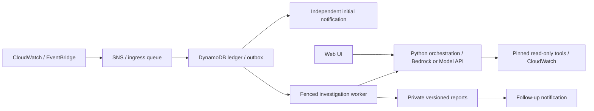

<p align="center">
  <picture>
    <source media="(prefers-color-scheme: dark)" srcset="assets/tracaus-logo-animated-white.svg">
    
  </picture>
</p>

<p align="center">
  <strong>Trace the cause.</strong><br />
  An AI incident investigator for your AWS EC2 and ECS workloads<br />
  Read-only. Runs in your account. No hosted service. Just <code>streamlit run app.py</code> to try it.
</p>

<p align="center">
  <a href="https://github.com/hamzashah14/Tracaus/actions/workflows/ci.yml"></a>
  <a href="LICENSE"></a>
  
  
  <a href="https://github.com/hamzashah14/Tracaus/stargazers"></a>
</p>

<p align="center">
  <a href="#quick-start">Quick Start</a> ·
  <a href="#features">Features</a> ·
  <a href="#what-it-reads">What it reads</a> ·
  <a href="#how-it-works">How it works</a> ·
  <a href="#three-choices">Choices</a> ·
  <a href="#deploy-to-your-aws-account">Deploy</a> ·
  <a href="#faq">FAQ</a> ·
  <a href="#documentation">Docs</a>
</p>

---

## What is Tracaus?

Tracaus (trace + cause) is a free, open-source AIOps assistant for AWS.

When a CloudWatch alarm fires, it reads the logs and metrics of the affected EC2
instance or ECS service, asks an AI model (Amazon Bedrock by default) to reason over that
evidence, and writes a short report that separates what was observed from what is only a
guess. You get the alert first and a link to the report when it is ready. You can also ask
questions in a web chat. You run all of it in your own AWS account.

> **Status:** locally tested, never run against real AWS. Treat your first deployment as staging.

## Quick Start

You need Python 3.12. The preview needs no AWS account. Create a virtual environment and
activate it. Every command in this README then works as written, as long as your prompt
shows `(.venv)`. Run the `source` line again in each new terminal.

```bash
python3.12 -m venv .venv
source .venv/bin/activate
python -m pip install --require-hashes -r requirements/app.lock
cp .env.example .env    # skip this if you already have a .env, and keep yours
chmod 600 .env
```

In `.env`, keep `ENVIRONMENT=development` and set `APP_PASSWORD` to a private value
of at least 12 characters. Then start the UI and open `http://127.0.0.1:8501/`:

```bash
streamlit run app.py --server.address 127.0.0.1
```

Sign in with that password. With no backend settings, the UI shows a "Connect your
runtime" checklist and chat stays disabled. That is expected. The same password
sign-in is the default mode of a deployed backend; the FAQ explains what it does and
does not protect.

### Try it against your own CloudWatch (no deployment)

<details>
<summary>Steps and limits</summary>

For development, the UI can run its two read-only tools (`fetch_logs`, `fetch_metrics`) in
its own process with your AWS credentials. You skip the tool Lambdas and `infra.deploy.automation`.

1. Write the one-file tool config: copy `examples/local-tools.example.json` and edit it, or
   generate it from a `deployment.json` (the shape of `examples/deployment.example.json`).
   Generating makes no AWS call and will not overwrite a file without `--force`:
   `mkdir -p .local && python scripts/make_local_tools.py --spec deployment.json --out .local/local-tools.json`
2. In `.env`, set `TRACAUS_LOCAL_TOOLS=.local/local-tools.json`, `APP_PASSWORD`, `BEDROCK_REGION`,
   `BEDROCK_MODEL_ID` and `EXPECTED_ACCOUNT_ID`. Keep `ENVIRONMENT=development` and the prefilled
   `RUNTIME_LIMITS`. Leave `LOGS_TOOL_ARN`, `METRICS_TOOL_ARN` and `RUNTIME_RELEASE` empty.
3. Use a read-only AWS profile (`AWS_PROFILE` in `.env`, or an SSO sign-in) with
   `logs:DescribeLogGroups`, `logs:StartQuery` (billable), `logs:GetQueryResults`,
   `logs:StopQuery`, `cloudwatch:GetMetricStatistics`, and `bedrock:InvokeModel` and
   `bedrock:CountTokens` on your model. Tracaus does not check that it matches `EXPECTED_ACCOUNT_ID`.
4. Run `streamlit run app.py --server.address 127.0.0.1` and sign in. "Connection details"
   shows "Local tools (this machine's AWS credentials)".

**Limits.** The tools read log groups named `<log_prefix>/<instance-id>/<suffix>`, the
layout of the agent file in [SERVERS.md](docs/SERVERS.md), and the groups you list under
`existing_log_groups` ([SERVERS.md](docs/SERVERS.md#use-log-groups-that-already-exist)). Any other
group, such as `/aws/lambda/...`, is out of reach. The UI process holds your read credentials, so Tracaus's checks run in code and
IAM does not back them up. Keep the UI on `127.0.0.1`. Use the deployed tools for anything
shared or production. This mode has never run against real AWS either, and it covers EC2 instances only.

</details>

## Features

<details open>
<summary><strong>Evidence first, guesses labelled</strong></summary>

Each report separates what was observed in logs and metrics from what is only a hypothesis.
Missing logs alone are not treated as proof of a hang.

</details>

<details>
<summary><strong>EC2 and ECS</strong></summary>

List EC2 instances, ECS services (Fargate or EC2 launch type), or both, up to 10 in total.
For ECS, Tracaus reads where ECS sends things by default: `awslogs` log groups, `AWS/ECS` and
load balancer metrics, and EventBridge task events. See [SERVERS.md](docs/SERVERS.md#ecs-services).

</details>

<details>
<summary><strong>Read-only, no automatic fixes</strong></summary>

Its tools only read CloudWatch logs and metrics for the EC2 instances and ECS services you list,
and, for an ECS service, its state (deployments, stopped tasks, load balancer health).
Tracaus suggests; a person decides and acts.

</details>

<details>
<summary><strong>The alert never waits for the model</strong></summary>

The first alert is sent without waiting for the model. If the model is down, the investigation
is retried within fixed limits, then recorded as degraded.

</details>

<details>
<summary><strong>Your account, your bill</strong></summary>

Everything is deployed and operated by you, in your AWS regions. AWS bills Bedrock, CloudWatch,
Lambda and the other services to you. A Model API provider, if you pick one, bills you separately.
There is no maintainer account, control plane or subscription.

</details>

<details>
<summary><strong>Chat with the same tools</strong></summary>

The web UI lets you ask follow-up questions. Chat uses the same pinned read-only tools as the
automatic investigations, under the runtime limits.

</details>

## What it reads

| | EC2 instance | ECS service (Fargate or EC2 launch type) |
|---|---|---|
| Logs | CloudWatch agent log groups, and existing log groups you list | `awslogs` log groups, such as `/ecs/<family>` |
| Metrics | CloudWatch agent metrics (CPU, memory, disk, optional Nginx and process) | `AWS/ECS` CPU and memory, `AWS/ApplicationELB` if an ALB is in front, Container Insights if you turn it on |
| Events | Instance stop | Task stopped (EventBridge) |
| Service state | n/a | Deployments, service events, stopped tasks with stop code and container exit codes, load balancer target health |
| You set up | CloudWatch agent, heartbeat, Nginx logging | `awslogs` driver, and Container Insights if you want it |

Tracaus never installs anything on your servers or tasks. Server setup stays with you:
[EC2](docs/SERVERS.md), [ECS](docs/SERVERS.md#ecs-services).

## How it works



Each investigation is limited in tokens, tool calls, query windows and time. See the
[architecture and glossary](docs/ARCHITECTURE.md).

## Three choices

You make each choice when you deploy. The defaults need the least setup.

| Choice | Default | Option |
| --- | --- | --- |
| Who signs in | **Local single-user mode.** One shared password protects the web UI. | **Team mode.** Several people share one UI. Each signs in through your identity provider with MFA and sees only the instances on their entry in a `team.toml` file on the UI host. No AWS resources. |
| Which model | **Amazon Bedrock.** | **Model API.** An OpenAI-compatible or Anthropic Messages endpoint. Its key lives in AWS Secrets Manager. |
| Where it runs | **Standalone AWS Lambda.** | **Amazon Bedrock AgentCore.** Bedrock only, so it cannot be combined with a Model API or team mode. |

Pass `--team-file` to the UI launcher for team mode. Set `model_provider` in
`deployment.json` for a Model API. The [deployment guide](docs/DEPLOY.md) covers both.
The Model API option has never run against a live provider, and diagnosis quality
on non-Claude models is unmeasured.

## Deploy to your AWS account

Three commands. Each one explains what it is doing, step by step, and can be run again.

```bash
./bin/tracaus setup    # read your account, ask a few questions, write the settings, show the plan
./bin/tracaus deploy   # check permissions, create the resources with live progress, handle each stop
./bin/tracaus ui       # open the UI on http://127.0.0.1:8501
```

- `setup` reads your running EC2 instances and ECS services (read-only), asks which to watch, and tells you what
  is still missing on each server or task. Installing the CloudWatch agent and shipping logs stays your job.
- You need an administrator-level AWS profile **once**, only to create the three IAM roles (if they do not exist
  yet). `setup` asks before it does that, and never uses that profile again. `deploy` and `ui` run as the roles.
- `deploy` never routes anything to Tracaus before its `routing` stage, stops for the paid model request and for the
  subscription emails, and never deletes anything. `./bin/tracaus status` shows where it is at any time.

Needs macOS or Linux (Windows: WSL), Python 3.12, Git and a clean checkout. Full guide, flags and the manual
commands behind these three: [deployment guide](docs/DEPLOY.md).

## What does it cost?

There is no cost estimate yet. The main cost drivers are:

- **Model tokens** for each automatic investigation and each chat question: Bedrock, or your Model API provider's bill.
- **CloudWatch** log ingestion, Logs Insights queries, metrics and alarms.
- **Always-on storage and keys:** DynamoDB (with point-in-time recovery), S3 versioning, KMS and Secrets Manager.
- **Messaging and compute:** Lambda, SNS and SQS, plus optional AgentCore.

Limits on tokens, tool calls and queries bound each request, but they are not a
dollar cap, and billing alerts do not stop spend. Stored data, keys and alarms keep
costing money while investigations are paused. Watch Cost Explorer for the first
week, and set a budget before you enable investigations. To cut model spend fast,
pause investigations and stop chat ([operations](docs/OPERATE.md)).

## FAQ

<details>
<summary><strong>Does Tracaus change my servers?</strong></summary>

No. Its tools only read CloudWatch logs and metrics, and recommendations are text for a
person to review. Setup does create AWS resources of its own, and you install the CloudWatch
agent on your servers yourself ([server setup](docs/SERVERS.md)).

</details>

<details>
<summary><strong>Can I use it without OIDC/SSO?</strong></summary>

Yes, that is the default. The UI then has one shared password, and chat runs with the UI's own
AWS role. The instance allowlist, pinned tools, runtime limits, release binding and redaction
still apply. Per-person sign-in, audit, revocation and a shared spend cap do not exist, and the
20 requests per hour limit is per browser session, so a new session resets it. Anyone with the
password can use the model and tools the UI role reaches and read every incident report. Keep
the UI on `127.0.0.1` or behind your own SSO or VPN proxy, or use team mode. Details:
[SECURITY.md](SECURITY.md).

</details>

<details>
<summary><strong>What if the model is down?</strong></summary>

The initial alert is still sent. The investigation is retried within fixed limits, then
recorded as degraded ("operator review required"). Chat shows an error with a reference.

</details>

<details>
<summary><strong>Is my data sent anywhere?</strong></summary>

With Bedrock, redacted log and metric excerpts go to Amazon Bedrock in your account and region.
With a Model API, those excerpts and the questions you type leave your AWS account for the
provider's HTTPS endpoint. That provider sets its own retention and quotas and bills you.
Reports are stored in a private, versioned S3 bucket you own. Output is redacted by pattern
matching before it returns to the model or is stored; this is best effort, not a guarantee.
Tracaus makes no calls to the maintainers, and Streamlit usage statistics are turned off.

</details>

<details>
<summary><strong>Can I use a model other than Bedrock?</strong></summary>

Yes, on standalone Lambda: an OpenAI-compatible endpoint with tool calling, or the Anthropic
Messages API. Run the paid staging canary and the
[diagnostic evaluation](evaluations/diagnostics/README.md) against it first. An OpenAI-compatible
endpoint has no token-count call, so Tracaus reserves a local estimate that is not an upper
bound. It stops the run if the provider reports more input than estimated, or no usage.

</details>

<details>
<summary><strong>What is not supported yet?</strong></summary>

Automatic discovery (you list instances and ECS services), EKS, Network and Gateway load
balancers in front of ECS, health probes of private VPC-only endpoints, a desktop app, Windows
servers (the telemetry setup is for Linux EC2) and a Model API with AgentCore.

</details>

## Folder structure

```text
bin/tracaus          the three commands: setup, deploy, status, ui
app.py               the web UI (Streamlit)

tracaus/             the product. Runs in AWS (inside the Lambdas) and in the UI
lambda/              thin Lambda entry points; each one calls code in tracaus/

infra/               deployment tooling. Runs on your computer only, never in AWS
  spec.py            reads and checks your deployment.json
  guided/            what bin/tracaus runs: discovery, questions, deploy with progress
  stacks/            writes the CloudFormation templates
  deploy/            plan, check, apply, verify and seal a release
  maintain/          day-2 work: retire old resources, change recipients, erase data

scripts/             small helpers: build the Lambda ZIPs, server heartbeat, replay, run the UI
  dev/               checks for CI and maintainers; users never need these

schemas/ config/     tool contracts and the default metric catalog, shipped inside the Lambdas
agent-instruction.txt  the prompt the model receives
examples/            sample deployment.json files that setup and the docs start from
evaluations/         synthetic diagnostic cases for testing report quality
docs/                the guides below
tests/               offline tests (no AWS needed)
requirements/        hash-pinned dependency locks
assets/              logo files
```

Where code runs: **`tracaus/` and `lambda/` run in your AWS account and in the UI. `infra/` and `scripts/` run on
your computer (or your servers, for the heartbeat).** [CONTRIBUTING.md](CONTRIBUTING.md#where-each-file-fits)
says what each file does.

## Documentation

1. [Prerequisites](docs/PREREQUISITES.md): what must exist and be decided before you run the deploy tool.
2. [Deployment guide](docs/DEPLOY.md): prerequisites, costs, setup, optional team mode and Model API.
3. [Server setup](docs/SERVERS.md): CloudWatch agent, heartbeat and Nginx on your hosts, and ECS services.
4. [Operations](docs/OPERATE.md): incidents, replay, recipients, rotation, erasure, restore.
5. [Architecture](docs/ARCHITECTURE.md): components, workflows and a glossary.
6. [Live acceptance](docs/ACCEPTANCE.md): the checklist to complete before relying on it.
7. [Diagnostic evaluations](evaluations/diagnostics/README.md): synthetic cases and optional paid model tests.

## Community

Questions, bug reports and feature ideas are welcome as [GitHub issues](https://github.com/hamzashah14/Tracaus/issues).
Report a vulnerability privately, as described in [SECURITY.md](SECURITY.md).

## Star History

<p align="center">
  <a href="https://www.star-history.com/?repos=hamzashah14%2FTracaus&type=date&legend=top-left">
    <picture>
      <source media="(prefers-color-scheme: dark)" srcset="https://api.star-history.com/chart?repos=hamzashah14/Tracaus&type=date&theme=dark&legend=top-left" />
      <source media="(prefers-color-scheme: light)" srcset="https://api.star-history.com/chart?repos=hamzashah14/Tracaus&type=date&legend=top-left" />
      
    </picture>
  </a>
</p>

## Contributors

<a href="https://github.com/hamzashah14/Tracaus/graphs/contributors">
  
</a>

See [CONTRIBUTING.md](CONTRIBUTING.md) for setup and checks.

## License

[MIT](LICENSE). Dependencies keep their own licenses.
